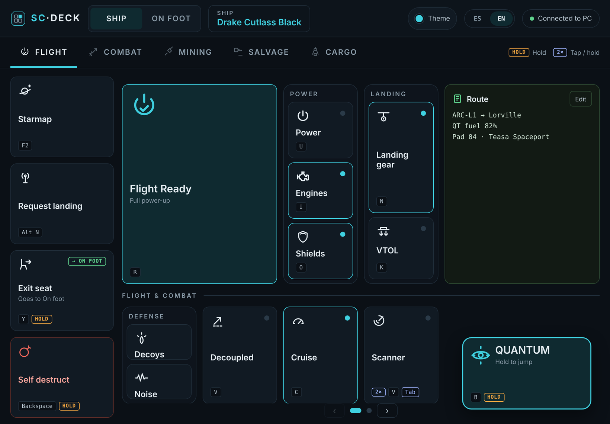
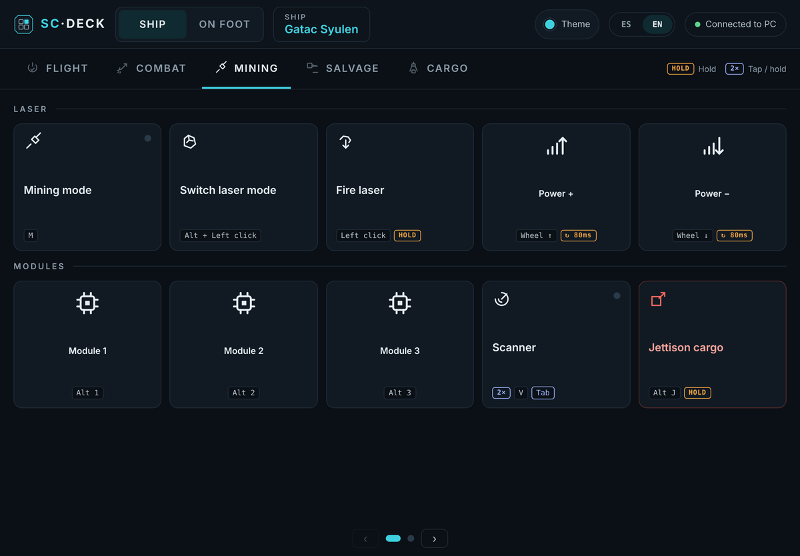
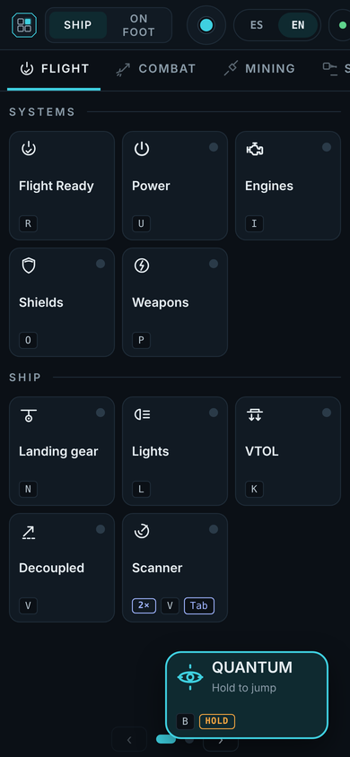
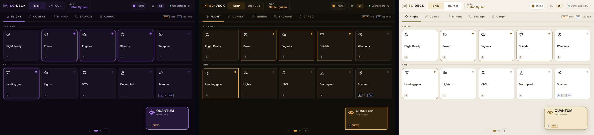
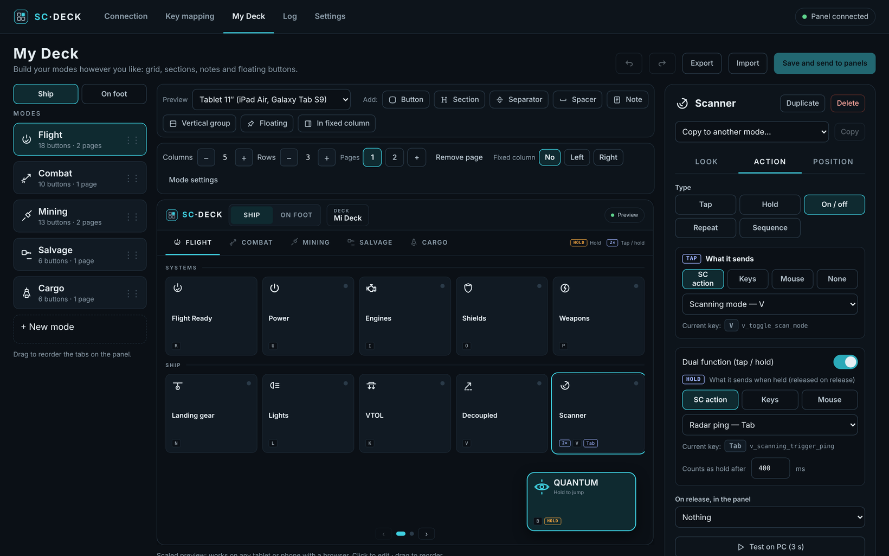
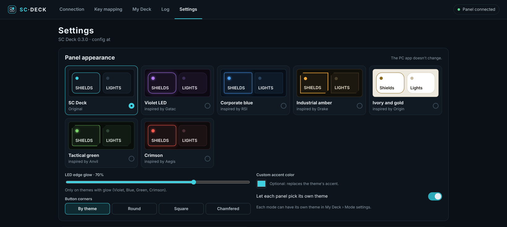
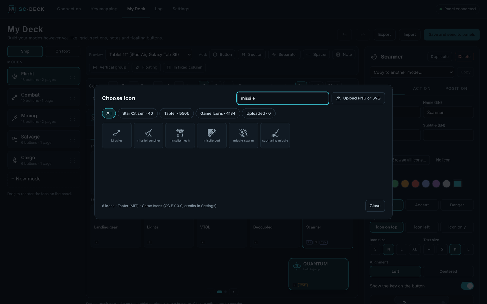

  

<h1 align="center">SC·DECK</h1>

  A touch button panel for <b>Star Citizen</b> on your tablet or phone.

  <a href="../../releases/latest"><b>⬇ Download the latest version</b></a> · Windows 10/11 · English / Español

  

---

## What is it?

SC Deck turns any tablet or phone into a button panel for Star Citizen, like a Stream Deck without buying any hardware.

- **On your PC** you install the SC Deck app. It receives your taps and sends them to the game as real key presses and mouse clicks.
- **On your tablet or phone** you open a web page in the browser (Safari, Chrome…). There's no app to install.

Build it however you like: a mode for each activity, your own buttons, your own keys and your own icons.

## Features

### 🎛️ A mode for every activity
- **Ship:** Flight, Combat, Mining, Salvage, Cargo, or your own modes.
- **On foot:** FPS, EVA, or your own modes.
- Each new mode starts from a **template**, a blank page, or a copy of another mode.
- Buttons can **jump to another mode**, **toggle between two modes**, or switch to *On foot* / *Ship*.

### 🚀 Knows which ship you're in
- SC Deck reads the game's `Game.log` (read-only) and shows the **name of the ship you boarded** on the panel.
- It can **switch the panel to Ship when you board** and **to On foot when you leave the pilot seat**. Each one can be turned off in Settings.

### ⌨️ Uses your keys
- Reads your `actionmaps.xml`, so every button uses **your** key even if you changed your controls. Change a key in the game and SC Deck picks it up by itself.
- **Key combos** (Ctrl, Alt, Shift + key).
- **Mouse:** left, right and middle click, wheel up/down and side buttons.
- **Any combination:** mix any keys with any number of mouse buttons in one binding (for example *Alt + right click*).
- **Button types:** tap, hold (while touched or for a fixed time), on/off toggle, step sequence, and **repeat every X ms** (while touched or N times). Times go up to 30 seconds.
- **Hold during:** keep a key or mouse button held while a repeat or a sequence runs (for example, hold left click + wheel up × 5).
- **Dual function:** tap does one thing and hold does another (for example, the scanner).
- **Default keys from the game:** SC Deck reads the default bindings from the game files (`Data.p4k`, read-only), so actions you never rebound still show the right key.

### 🧩 Free layout
- Columns × rows grid, with buttons in different sizes.
- **Sections**, separators and spacers.
- **Notes** you can edit from the PC or the panel (scanner frequencies, routes, anything).
- A **fixed column** on the left or right.
- **Floating buttons** anchored to 9 points of the screen.
- **Pages** inside a mode: swipe or use the arrows.
- **Vertical groups:** stack several buttons in one grid cell, each with its own relative height.
- **Phone portrait** layout with 3 columns.

  
  

### 💡 LEDs that stay in sync
- On/off buttons show an LED. Press the key on your **keyboard** (for example N for the landing gear) and the panel's LED follows.
- LEDs also stay in sync **between panels**: use a tablet and a phone and both show the same.
- Optionally only while Star Citizen is the active window.

### 🎨 Themes
- **15 panel themes**, many inspired by ship manufacturers: SC Deck, Violet LED, Corporate blue, Industrial amber, Ivory and gold (light), Tactical green, Crimson, Neon pink, Hazard yellow, Freighter teal, Sky and white (light), Ancient bronze, Jade, Pioneer orange and White LED.
- **Custom theme:** pick your own background, button, text and accent colors. Borders and the lit-button color are worked out for you, with a live preview.
- Adjust the **LED glow**, the **button corners** (round, square, chamfered) and a **custom accent color**.
- Give **each mode its own theme**, for example Mining in amber and Combat in crimson.
- Optionally let each panel pick its own theme from the color button at the top.

  

### 🖼️ Icons and look
- **~9,680 built-in icons** that work offline: 40 Star Citizen icons, Tabler and Game Icons.
- Search in English or Spanish, or **upload your own PNG or SVG**.
- For each button pick the color, icon size (S–XL), text size, icon on top / on the left / icon only, alignment, and whether it shows the key. Apply it to a whole mode at once.

### 🖥️ PC app
- **My Deck:** an editor with a to-scale preview (8″, 11″ and 13″ tablets, phone landscape and portrait, or a custom size). Undo/redo, copy buttons to another mode, and reorder modes by dragging them.
- **Key mapping:** shows which key each action uses and warns about conflicts or unassigned actions.
- **Log:** shows live what the panel sent and which key went to the game.
- **Settings:** appearance, language, backup (`.scdeck` files), administrator rights and the firewall rule.
- Several panels at once. Each new device must be **approved** on the PC before it can send keys.

  

  
  

### 🔄 Updates itself
On start, the app checks for new versions. It only installs **signed** updates, waits until you close Star Citizen, and keeps your Deck and settings. Panels reload by themselves.

---

## Install

1. Download **`SC-Deck_x.y.z_x64-setup.exe`** from [Releases](../../releases/latest).
2. Run it. Windows will show **SmartScreen** ("Windows protected your PC") because the app has no commercial certificate. Click **More info › Run anyway**. This only happens on the first install.
3. The installer creates the **firewall** rule so your tablet or phone can connect.

## Getting started

1. Open **SC Deck** on the PC and go to **Connection**.
2. Scan the **QR code** with your tablet or phone. It must be on the **same WiFi network** as the PC.
3. "New device" shows up on the PC: click **Approve**.
4. In the panel's browser, use **Share › Add to Home Screen** to get it full screen.
5. Check **Key mapping**, then customize your Deck in **My Deck**. When you're done, click **Save and send to panels**.

To switch languages, go to **Settings › Language**. Each panel can also use the ES / EN toggle at the top.

## Troubleshooting

| Problem | Fix |
|---|---|
| The panel won't connect / `ERR_TOO_MANY_RETRIES` | In Windows, the PC's network must be **Private**. Check the rule in **Settings › Windows › Create / repair rule**. Make sure both devices are on the same WiFi. |
| I tap a button and the game doesn't react | If Star Citizen runs **as administrator**, SC Deck must too (**Settings › Windows**). Check in **Log** which key was sent, and in **Key mapping** that the action has a key. |
| A button says "Unassigned" | That action has no key in your controls. Assign one in the game, or capture a key in **Key mapping** or on the button. |
| The ship name doesn't show | Check **Settings › Current ship** and that the log path points to your `Game.log` (in the game's `LIVE` folder). |
| I want to move my Deck to another PC | **Settings › Export** creates a `.scdeck` file. On the other PC use **Import**. |

## FAQ

**Can I get banned?** SC Deck simulates a keyboard and mouse, like Stream Deck or VoiceAttack, and only reads configuration and log files. It doesn't touch the game process or its memory. Use it as a button shortcut, not to automate gameplay.

**Does it work with iPad, Android, iPhone…?** Yes, with any device that has a modern browser.

**Where is my configuration saved?** In `%APPDATA%\cl.scdeck.app\`. Updates don't erase it.

---

## Credits

- [Tabler Icons](https://tabler.io/icons) — Paweł Kuna — MIT
- [Game Icons](https://game-icons.net) — Lorc, Delapouite and contributors — CC BY 3.0
- Star Citizen icons drawn for SC Deck.
- Fonts: Chakra Petch, Exo 2, Rajdhani, Saira Condensed, Lexend, Oxanium, Inter and JetBrains Mono (SIL Open Font License).

> SC Deck is a fan project, not affiliated with Cloud Imperium Games. Star Citizen® is a trademark of Cloud Imperium Rights LLC.
